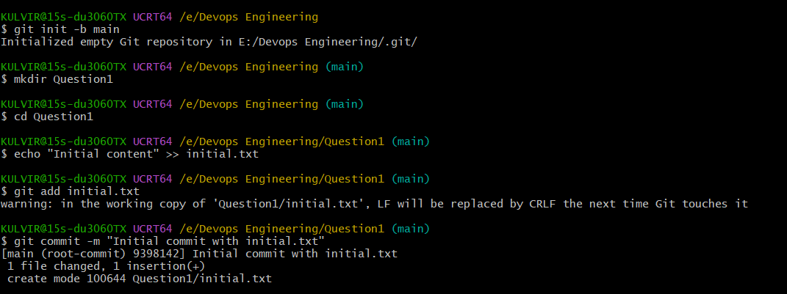

# Git Basics: Initialization, Staging, and Unstaging

This repository demonstrates basic Git commands, specifically how to initialize a repository, make an initial commit, and use `git restore` and `git reset`.

### 1. Initialize a Local Git Repository & Initial Commit
- Created a local Git repository on the machine.
- Added an initial file (`initial.txt`) with some content and committed it to the `main` branch.

### 2. Stage and Unstage a File (Using git restore)
- Created and staged a second file (`temp.txt`).
- Unstaged it using the command `git restore --staged temp.txt`.

_temp.txt.png)

### 3. Modify, Stage, and Unstage (Using git reset)
- Modified the `temp.txt` file.
- Staged it again.
- Unstaged it this time using the older method: `git reset HEAD temp.txt`.

_temp.txt.png)